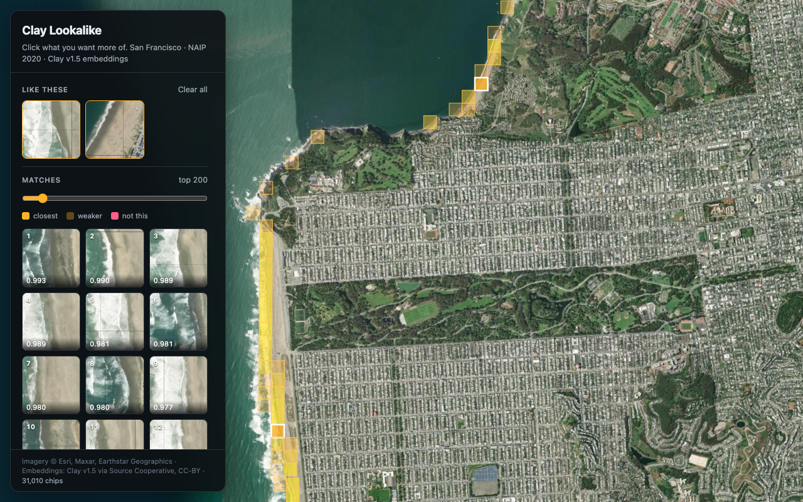

# Clay Lookalike

Click a few things on an aerial map of San Francisco and every 154 m chip that
looks like them lights up. No model runs on your machine: the app searches the
**precomputed Clay v1.5 embeddings** of NAIP 2020 imagery that the Clay
Foundation publishes on Source Cooperative, one 1024-number vector per chip.

## How to use it

1. **First run:** press *Fetch San Francisco*. The app downloads the 19 scene
   files that cover the city (about 150 MB downloaded, kept as roughly 260 MB of
   numpy arrays in the app’s own `.fused/cache/`),
   and builds one index of 31,010 chips that every query memory-maps. The
   download shows up in
   fused-render's download manager and can be cancelled and resumed.
2. **Zoom in and click a chip** that shows what you want more of: a ball
   field, a marina, a cemetery, a parking structure. Click more chips to widen
   the idea. Each click is an example, not a label. The quick-start links under
   the hint (ball fields, marinas, beaches) load a verified example in one click.
3. **Shift-click** a chip to say *not this*. Its lookalikes are pushed down.
4. The **matches** are coloured amber on the map, closest first, and the top
   24 are shown as real aerial crops in the panel. Click a thumbnail to fly
   there. The slider sets how many chips are highlighted (20 to 2000).

Selections and the map view live in the URL, so a view can be bookmarked or
shared with anyone who has the app and the cache.

## How it works

- Every chip is scored by **cosine similarity** to its closest example, minus
  its similarity to the closest *not this* chip. Using the closest example
  rather than an average means two unrelated examples both work.
- Scoring 31k chips is a single matrix product in numpy and takes well under a
  second per click; nothing is precomputed beyond the download.
- Chips overlap where NAIP scenes overlap, so the build step keeps only the
  chips whose centre falls inside their scene's nominal quarter-quad box.
- The basemap is Esri World Imagery, which is more recent than the 2020 NAIP
  the embeddings were computed on. Where the ground changed, a match can look
  wrong on today's imagery; the vector still describes 2020.

## Data and credit

- Embeddings: [Clay v1.5 NAIP embeddings](https://source.coop/clay/clay-v1-5-naip-2)
  by the Clay Foundation and Development Seed, CC-BY 4.0. This app reads the
  `ca/2020/60cm/rgbir_cog/37122/` scenes for quads 12–14 and 20–22.
- Imagery: © Esri, Maxar, Earthstar Geographics and the GIS user community.
- deck.gl is loaded from unpkg at render time.

## Files

- `index.html` — the page: deck.gl map, selection, download flow, thumbnails.
- `lookalike.py` — fetch, build and query; see `SKILL.md` for the bot-callable
  interface.
- `test_lookalike.py` — unit tests, run locally with `uv run --no-project --with pytest --with numpy --with pyarrow --with requests pytest test_lookalike.py` (the showcase CI skips them: this folder is scripts, not an installable package).
