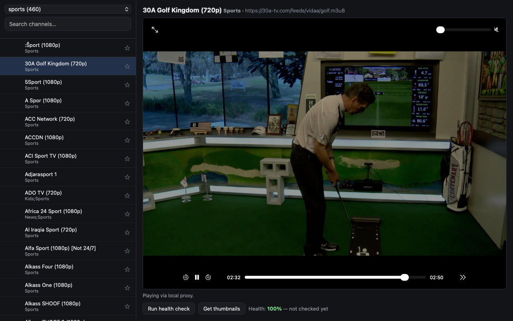

# OpenTV



A desktop IPTV player. OpenTV pulls the public
[iptv-org](https://github.com/iptv-org/iptv) playlists, lists the channels in a
searchable sidebar, and plays the selected stream in-page with
[hls.js](https://github.com/video-dev/hls.js). Because public IPTV streams are
a graveyard of dead links, it also keeps score: a background signal check
probes every URL in a category and remembers which ones keep failing, and a
thumbnail grabber pulls one real frame per channel so you can see what's
actually on before you click.

## Using it

1. Pick a category from the dropdown (`sports` by default; ~30 categories,
   plus `all`). The playlist is fetched once and cached for 24 hours.
2. Type in the search box to filter, click a channel to play. The first play
   starts the local proxy for you (see below). Every click begins with a
   **signal check**: within a few seconds the status line says either what
   the URL serves and that it is loading, or why there is no signal
   (`HTTP 404`, `timed out`, `DNS lookup failed`, `serves web page, not a
   stream`, …) — no more staring at a black player while the stream retries.
3. Click the star on a channel to favorite it; the `favorites` category lists
   everything you've starred.
4. **Run signal check** probes every stream in the current category
   concurrently and streams live progress into the sidebar. A channel counts
   as responsive only when there is really something to play: its playlist
   lists segments and the newest segment answers (or it serves raw MPEG-TS /
   DASH, which play through ffmpeg). Failures are remembered across runs, so
   a channel that fails repeatedly gets a visible fail percentage; hover the
   dot to see what it serves and the last error.
5. **Get thumbnails** grabs one frame per channel (skipping channels that
   have never once responded) and shows them in the list.

Both background jobs run in a detached worker process, so you can keep
watching — or close the page — while they finish, and cancel at any time.
Over the ~450-channel `sports` category the signal check takes about 10–20 s
and the thumbnail run about half a minute; most of that is dead hosts sitting
in their connect timeout.

## How a channel gets played

Public IPTV streams come from arbitrary hosts with no CORS headers, lying
content types, gzip-compressed playlists, and codecs browsers don't decode.
`proxy.py` — a stdlib-only local HTTP server on `127.0.0.1:8787` — takes care
of all of it, and the page always goes through it:

1. `/check` — the signal check. One small server-side GET classifies what the
   URL serves (`hls-master`, `hls-media`, `ts`, `dash`, `mp4`, `html`, `empty`,
   `dead`) and, for HLS, follows the master playlist to a media playlist and
   counts its segments.
2. `/proxy` — HLS plays through hls.js. The proxy fetches with a browser
   User-Agent and lenient TLS, decodes gzip, passes `Range` requests and
   upstream status codes through, and rewrites every playlist URI (variants,
   segments, AES keys, init maps) so hls.js never talks to the stream host.
   Non-playlist bodies are streamed through in chunks with a size cap, so an
   endless raw stream can't hang a thread. hls.js runs with short retry
   policies: the check already proved the playlist exists, so a failure now
   is reported in seconds, not after a 30 s retry ladder.
3. `/bridge` — anything hls.js can't play goes through ffmpeg: raw MPEG-TS,
   DASH, and streams whose codecs the browser rejects (HEVC, AC-3, MP2 — the
   `manifestIncompatibleCodecsError` case). The proxy probes the codecs,
   copies H.264 / AAC as-is and transcodes only what has to be (VideoToolbox
   on macOS, x264 elsewhere; audio to AAC), writing a short rolling HLS
   playlist that hls.js plays like any other. A bridge nobody has asked for
   in 30 s stops itself. The status line says which path is in use.

Fatal media errors trigger hls.js's standard recovery
(`recoverMediaError`, then `swapAudioCodec`) before falling back to the
bridge. If the proxy cannot be started at all, the page tries a direct
load, which works only for the minority of hosts that send CORS headers.

**Engines without H.264.** A Chromium built without proprietary codecs
(some embedded CEF builds) has no H.264/AAC in Media Source Extensions at
all; hls.js still reports itself as supported there and then fails every
stream with `bufferAddCodecError`, while thumbnails keep working because
ffmpeg decodes them outside the browser. On load the page probes what the
engine can decode (`playerCaps()`, written to `player_caps.json` by
`diag.py`) and, when H.264 is missing but VP9 is there, sends every stream
through the bridge with `target=vp9`: ffmpeg transcodes to VP9/Opus in
fragmented MP4 (1 s segments, ~2 s to first picture, a few CPU cores). The
same switch happens at runtime if an H.264 bridge output is refused.

**OpenTV starts the proxy for you.** `pyproject.toml` declares `proxy.py` as
the folder's fused-render background daemon, and the page calls
`fused.daemon.start()` the first time a stream needs it. fused-render keeps it
alive across page reloads and stops it when you quit the app. You can still
run it by hand:

```
python3 proxy.py              # listens on http://127.0.0.1:8787
python3 proxy.py --port 8797  # somewhere else, e.g. for tests
```

Port `8787` is hardcoded in `index.html` and `proxy.py`; change it in both if
it clashes with something else. If a hand-started proxy already holds 8787,
the managed daemon leaves it alone and the page uses whichever answers.
Failures and bridge events are logged to `~/.fused-render/cache/open-tv/proxy.log`.

## Thumbnails

`thumbnails.py` resolves the playlist in Python first: master → cheapest
variant with video → newest segment, downloads at most 1.5 MB of that segment
and decodes its first keyframe from a pipe. ffmpeg never probes a master
playlist or opens every variant, bandwidth per grab is bounded, and a dead
URL costs one failed GET with no ffmpeg process at all. Encrypted or
byte-range playlists fall back to ffmpeg's own HLS demuxer; raw MPEG-TS and
MP4 are decoded from the bytes already fetched; DASH goes to ffmpeg by URL.
Grabs run 24 at a time — the old 128 parallel ffmpeg processes starved each
other into timeouts.

## Requirements

- **Network access.** Playlists come from `iptv-org.github.io`, streams from
  whatever hosts the playlists point at. hls.js ships in `vendor/` (the CDN
  is only a fallback). Channel logos are loaded from the URLs in the playlist.
- **ffmpeg** — for "Get thumbnails" and for the ffmpeg bridge. HLS streams
  with H.264/AAC play without it. OpenTV looks on `PATH` and in
  `~/.local/bin`, `/opt/homebrew/bin`, `/usr/local/bin`. Install with
  `brew install ffmpeg` (macOS) or `sudo apt install ffmpeg` (Debian/Ubuntu).
  If it's missing, the thumbnail job and the bridge stop with a message
  saying so.
- **Python with `pyarrow`** for the health-stats parquet file. fused-render
  installs it from `pyproject.toml`.
- No accounts, credentials, or API keys.

## Where OpenTV stores its data

Everything it writes lives outside the app folder, under:

```
~/.fused-render/cache/open-tv/
├── playlists/       # cached .m3u files + category counts (24h TTL)
├── <md5>.jpg        # one thumbnail per channel URL
├── favorites.json   # starred channels
├── health.parquet   # per-channel tries / fails / last result / kind / last error
├── runs/<run_id>/   # background job event logs
├── bridge/<id>/     # rolling HLS segments of a running ffmpeg bridge
├── player_caps.json # what the page's engine can decode (for diagnosis)
└── proxy.log        # proxy failures and bridge events
```

Set `OPEN_TV_CACHE_DIR` to put it somewhere else. Deleting the directory just
costs you your favorites and health history — everything else refetches. A
full-category thumbnail run over `all` can grow to a few hundred MB of JPEGs.

## Tests

`tests/` runs the proxy, the stream helpers, the thumbnail grabber, the
signal check and the background worker against a local upstream that serves
every kind of thing a public URL turns out to be (HLS, gzip-compressed HLS,
an endless raw MPEG-TS stream, an HTML page, 404s, a hang). No internet
needed; ffmpeg builds the test media once.

```
.venv/bin/python tests/test_streams.py
.venv/bin/python tests/test_proxy.py
.venv/bin/python tests/test_jobs.py
```

## Limitations

- Stream quality is entirely out of OpenTV's hands. Public IPTV links die,
  move, rate-limit, and geo-block constantly; a channel that worked yesterday
  may be gone today. That's what the signal check is for.
- The bridge transcodes one stream at a time in real time; a 4K HEVC channel
  on a slow machine may stutter, and the VP9 path (engines without H.264)
  costs a few CPU cores for as long as you watch. Streams that need a login, cookies or a
  specific `Referer` don't work.
- The proxy is unauthenticated and will fetch any `http(s)` URL handed to it,
  and start ffmpeg on it. It binds to `127.0.0.1` only, but don't expose
  that port.
- Signal checks and thumbnail grabs are network-heavy — 192 concurrent
  probes, 24 concurrent grabs. Running one over the `all` category takes a
  while and is not gentle on your connection.
- OpenTV neither hosts nor rehosts any stream; it reads a public playlist and
  plays the URLs in it. Whether a given channel is licensed for you to watch
  is between you and its operator.
